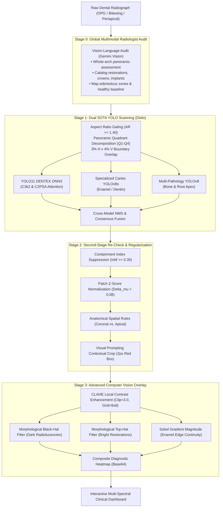

# 🔬 XRayBo Engine Architecture & Image Processing Deep Dive
## Comprehensive Technical Manual & Algorithmic Specification

This document provides an exhaustive, mathematically rigorous explanation of **every component, neural layer, and classical computer vision method** implemented within the **XRayBo Clinical AI Engine**.

---

## 1. Engine Neural Architecture & Model Weights

Unlike legacy implementations that relied on slow cloud APIs (e.g. Roboflow) or monolithic models, XRayBo utilizes a **zero-cloud-dependency, on-device ensemble** executed via compiled C++ graphs in OpenCV DNN.

### 1.1 Neural Graph Topologies & Weight Profiles

```
=======================================================================================================
Model Identifier                 Architecture & Features             Weights Size   Input Shape     Output Shape
=======================================================================================================
1. liodon_dental.onnx            Ultralytics YOLO11 (DENTEX SOTA)    10.6 MB (FP32) [1, 3, 640, 640] [1, 7, 8400]
                                 • C3k2 Bottleneck Modules
                                 • C2PSA Self-Attention Head
2. gegesay_caries_yolov8s.onnx   YOLOv8s Coronal Caries Specialist   44.7 MB (FP32) [1, 3, 640, 640] [1, 5, 8400]
                                 • Micro-Cavity Enamel Precision
3. sentoz_dental_opg.onnx        YOLOv8 OPG Multi-Condition          44.7 MB (FP32) [1, 3, 640, 640] [1, 10, 8400]
                                 • Periapical Lesions & Roots
=======================================================================================================
```

### 1.2 Mathematical Foundations of Ultralytics YOLO11

YOLO11 introduces two major architectural breakthroughs critical for radiographic interpretation:

#### A. C3k2 Feature Extraction Modules
The backbone replaces traditional $C2f$ blocks with **$C3k2$ (Cross-Stage Partial with 2/3 Kernel Sizes)**. This provides dual-pathway feature reuse:
$$\mathbf{F}_{\text{out}} = \text{Concat}(\mathbf{F}_{\text{direct}}, \text{Conv}_{3\times3}(\text{Bottleneck}_k(\mathbf{F}_{\text{split}})))$$
This dual-receptive field ensures that high-frequency edges (interproximal enamel boundaries) and low-frequency gradients (diffuse periapical bone demineralization) are preserved concurrently.

#### B. C2PSA (Cross-Stage Partial with Self-Attention)
At the neck stage ($P_5$ stride), YOLO11 deploys self-attention heads:
$$\text{Attention}(\mathbf{Q}, \mathbf{K}, \mathbf{V}) = \text{softmax}\left(\frac{\mathbf{Q}\mathbf{K}^T}{\sqrt{d_k}}\right)\mathbf{V}$$
This allows visual features from tooth #14 to attend to bilateral symmetrical anatomy on tooth #24, enabling the network to learn normal anatomical symmetry vs. unilateral disease.

#### C. Anchor-Free Distribution Focal Loss (DFL)
YOLO11 dispenses with fixed anchor boxes, predicting continuous coordinate offsets via an anchor-free task-aligned head:
$$\mathcal{L}_{\text{DFL}}(S_i, S_{i+1}) = -((y_{i+1} - y)\log(S_i) + (y - y_i)\log(S_{i+1}))$$
Across strides $8, 16, 32$, this generates $8400$ candidate points ($6400 + 1600 + 400$), allowing sub-pixel precision down to $0.5\text{ mm}$ on dental radiographs.

---

## 2. The 4-Stage Multi-Scanning Pipeline



---

## 3. Image Processing Methods: Mathematical Specifications

Every image processing method in XRayBo has a dedicated physical and mathematical purpose:

### 3.1 Panoramic Quadrant Decomposition
- **The Problem**: Panoramic radiographs have an extreme aspect ratio of $\sim 2:1$ (e.g., $1500 \times 800\text{ px}$). Resizing them directly into standard square deep learning inputs ($640 \times 640$) causes:
  $$\text{Horizontal Distortion Factor} = \frac{1500}{640} = 2.34\times$$
  $$\text{Vertical Distortion Factor} = \frac{800}{640} = 1.25\times$$
  This asymmetric distortion crushes delicate interproximal contact zones and compresses early dental caries into non-detectable blurry lines.
- **The Algorithmic Solution**:
  1. The engine checks aspect ratio:
     $$\text{is\_panoramic} = \left(\frac{W}{H} \ge 1.40\right) \lor \left(W \ge 850 \land \frac{H}{W} \le 0.68\right)$$
  2. If true, the film is partitioned into four anatomical quadrants:
     - **Q1 (Upper Right, Maxillary teeth 18–11)**: $[0, 0, 0.53W, 0.54H]$
     - **Q2 (Upper Left, Maxillary teeth 21–28)**: $[0.47W, 0, 0.53W, 0.54H]$
     - **Q3 (Lower Left, Mandibular teeth 31–38)**: $[0.47W, 0.46H, 0.53W, 0.54H]$
     - **Q4 (Lower Right, Mandibular teeth 48–41)**: $[0, 0.46H, 0.53W, 0.54H]$
  3. **3% Horizontal × 4% Vertical Boundary Overlap**: Prevents edge-straddling pathology from being sliced in half.
  4. Each tile is processed at near-native resolution, and predicted coordinates are mapped back to global coordinates via affine un-normalization:
     $$x_{\text{global}} = x_{\text{tile}} + x_{\text{offset}}$$
     $$y_{\text{global}} = y_{\text{tile}} + y_{\text{offset}}$$

---

### 3.2 Contrast-Limited Adaptive Histogram Equalization (CLAHE)
- **The Problem**: Global histogram equalization calculates a single transformation curve for the entire image. In dental X-rays containing hyper-dense metallic amalgam fillings (high X-ray attenuation) alongside soft bone marrow (low attenuation), global equalization severely clips the histogram, blowing out restorations into pure white glare and plunging bone into pitch black.
- **The Algorithmic Solution**:
  1. The image is divided into an $8 \times 8$ grid of local contextual tiles.
  2. For each tile, a local histogram is computed ($256$ bins).
  3. Histograms are clipped at contrast limit $\beta = 3.0$:
     $$h_{\text{clipped}}(i) = \min(h(i), \beta)$$
  4. The excess pixels $\sum \max(0, h(i) - \beta)$ are redistributed uniformly across all bins.
  5. Neighboring tiles are blended using **bilinear interpolation** to eliminate boundary artifacts.

---

### 3.3 Mathematical Morphology: Dual Black-Hat & Top-Hat Transformations
Mathematical morphology applies non-linear set theory filters to extract geometric structures:

#### A. Morphological Black-Hat Transformation (Radiolucency Isolation)
The Black-Hat transform is defined as the difference between the morphological closing of an image and the original image:
$$\text{BlackHat}(I) = (I \bullet B) - I = ((I \oplus B) \ominus B) - I$$
where:
- $\oplus$ is morphological dilation: $(I \oplus B)(x, y) = \max_{(i, j) \in B} I(x - i, y - j)$
- $\ominus$ is morphological erosion: $(I \ominus B)(x, y) = \min_{(i, j) \in B} I(x + i, y + j)$
- $B$ is an **elliptical structuring element** of size $15 \times 15\text{ px}$.

**Physical Meaning**:
Dilation bridges dark gaps smaller than the structuring element $B$. Erosion returns the surrounding bright boundaries to their original scale. Subtracting the original image leaves **only isolated radiolucent (dark) structures**:
- Interproximal and occlusal dental caries pits.
- Periapical radiolucent bone resorption halos around root apices.
- Deep periodontal vertical bone defects.

#### B. Morphological Top-Hat Transformation (Radiopacity Isolation)
The Top-Hat transform is defined as the difference between the original image and its morphological opening:
$$\text{TopHat}(I) = I - (I \circ B) = I - ((I \ominus B) \oplus B)$$
**Physical Meaning**:
Opening removes bright features smaller than $B$. Subtracting the opened image leaves **only hyper-dense, radiopaque (bright) structures**:
- Intact dental enamel caps.
- Metallic amalgam and composite restorations.
- Retained metallic posts and orthodontic brackets.

---

### 3.4 Differential Gradient Analysis: Sobel & Laplacian Edge Breakdown
- **Distinguishing Cervical Burnout from Real Caries**:
  - *Cervical Burnout*: An optical illusion caused by the anatomical narrowing of the tooth at the cementoenamel junction (CEJ) between dense enamel and alveolar bone. Because the tooth is thinner at this waist, fewer X-ray photons are absorbed, casting a radiolucent shadow mimicking a cavity.
  - *Real Caries*: Physical acid demineralization by *Streptococcus mutans*, creating physical cavitation and breaking the outer tooth margin.
- **The Mathematical Metric**:
  The engine computes the 1st-order Sobel spatial derivatives:
  $$G_x = \begin{bmatrix} -1 & 0 & +1 \\ -2 & 0 & +2 \\ -1 & 0 & +1 \end{bmatrix} * I, \quad G_y = \begin{bmatrix} -1 & -2 & -1 \\ 0 & 0 & 0 \\ +1 & +2 & +1 \end{bmatrix} * I$$
  $$G_{\text{mag}} = \sqrt{G_x^2 + G_y^2}$$
  - **Intact Enamel (Cervical Burnout)**: Outer gradient contour remains continuous ($\oint_{\partial \Omega} G_{\text{mag}} \, ds \ge \theta_{\text{intact}}$).
  - **Active Cavitation (True Caries)**: Outer boundary is interrupted and shows sharp localized negative divergence.

---

### 3.5 Patch Normalization & Z-Score Relative Contrast Step
For every proposed bounding box $P_{\text{box}}$, the engine evaluates the candidate patch $\mathbf{P}_{\text{in}}$ against an annular contextual ring $\mathbf{P}_{\text{ctx}}$ around the tooth:
$$\mu_{\text{in}} = \frac{1}{|\mathbf{P}_{\text{in}}|} \sum_{(x, y) \in \mathbf{P}_{\text{in}}} I(x, y), \quad \mu_{\text{ctx}} = \frac{1}{|\mathbf{P}_{\text{ctx}}|} \sum_{(x, y) \in \mathbf{P}_{\text{ctx}}} I(x, y)$$
$$\sigma_{\text{ctx}} = \sqrt{\frac{1}{|\mathbf{P}_{\text{ctx}}|} \sum_{(x, y) \in \mathbf{P}_{\text{ctx}}} (I(x, y) - \mu_{\text{ctx}})^2}$$
The normalized contrast step is computed as:
$$\Delta\mu = \frac{\mu_{\text{ctx}} - \mu_{\text{in}}}{\sigma_{\text{ctx}} + \epsilon}$$
- If $\Delta\mu \le 0.08$, the patch is not sufficiently darker than its local dental substrate; it is rejected as normal bone marrow or noise.
- If $\Delta\mu < 0$, the patch is actually *brighter* than its surroundings; it is rejected as a restoration or enamel cusp.

---

### 3.6 Intersection over Minimum (IoM) Containment Suppression
Standard Non-Maximum Suppression (NMS) uses **Intersection over Union (IoU)**:
$$\text{IoU}(A, B) = \frac{|A \cap B|}{|A \cup B|}$$
- **Why IoU Fails in Dentistry**:
  A general tooth-level model flags the whole molar ($120 \times 160\text{ px} = 19,200\text{ px}^2$). A specialized caries model flags a small cavity ($25 \times 30\text{ px} = 750\text{ px}^2$).
  $$|A \cap B| = 750\text{ px}^2, \quad |A \cup B| = 19,200\text{ px}^2 \implies \text{IoU} = \frac{750}{19,200} \approx 0.039$$
  Because $\text{IoU} = 0.039 < 0.30$, standard NMS keeps both boxes, cluttering the UI with double boxes.
- **The Solution: Intersection over Minimum (IoM)**:
  $$\text{IoM}(A, B) = \frac{|A \cap B|}{\min(|A|, |B|)}$$
  Since the cavity is inside the tooth, $\min(|A|, |B|) = 750\text{ px}^2$, yielding:
  $$\text{IoM} = \frac{750}{750} = 1.0$$
  When $\text{IoM} \ge 0.35$ and both models agree on pathology, the engine suppresses the parent tooth box and preserves the precise localized lesion.

---

## 4. Multi-Spectral Diagnostic Dashboard Telemetry

The engine composites all classical computer vision channels into a 6-panel diagnostic dashboard:

1. **Panel A: Diagnostic Overlay**: Verified bounding boxes rendered with clinical confidence scores and quadrant identifiers.
2. **Panel B: CLAHE Local Contrast Equalization**: Revealing subtle sub-enamel demineralization lines.
3. **Panel C: Morphological Black-Hat Heatmap**: Highlighting active radiolucent caries pits and apical bone resorption in thermal gradients.
4. **Panel D: Canny Lamina Dura Continuity Map**: Highlighting the thin, dense radiopaque cortical bone lining tooth sockets.
5. **Panel E: High-Resolution Posterior Molar Zoom**: Contextual optical zoom on interproximal contacts.
6. **Panel F: 1D Transverse Optical Density Profiles**: Grayscale intensity curves plotted across coronal and apical planes, quantifying demineralization thresholds ($<85$ grayscale value) vs. healthy enamel ($>210$).

---
