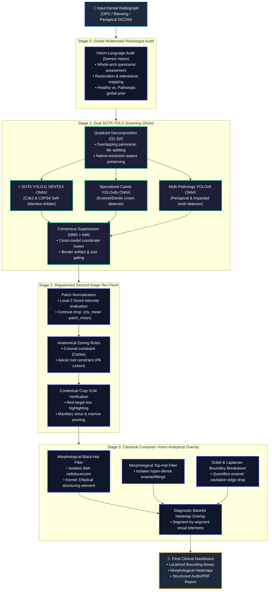
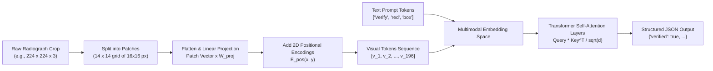
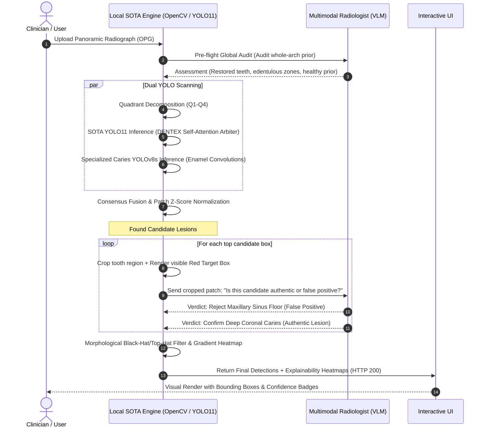

# 🦷 XRayBo: SOTA Dental Radiography Multi-Scanning & Clinical AI Engine

An enterprise-grade, multi-stage dental artificial intelligence system designed for panoramic orthopantomograms (OPGs) and intraoral radiographs. Powered by the latest **Ultralytics YOLO11** (featuring `C3k2` and `C2PSA` Cross-Stage Partial with Self-Attention) and specialized dental detection ensembles running on optimized ONNX/OpenCV DNN CPU runtimes, paired with multimodal Vision-Language Models (VLMs) and classical morphological computer vision algorithms.

---

## 📑 Table of Contents
1. [Architectural Overview](#-architectural-overview)
2. [What is the Engine Actually Made Of? (YOLO11 & Ensembles)](#-what-is-the-engine-actually-made-of)
3. [Empirical Benchmark: YOLOv8 vs. SOTA YOLO11](#-empirical-benchmark-yolov8-vs-sota-yolo11)
4. [How Vision-Language Models Tokenize & "See" Dental Radiographs](#-how-vision-language-models-tokenize--see-dental-radiographs)
5. [Engine Reasoning vs. LLM Reasoning (The Dual-Brain Paradigm)](#-engine-reasoning-vs-llm-reasoning-the-dual-brain-paradigm)
6. [The 4-Stage Multi-Scanning Pipeline](#-the-4-stage-multi-scanning-pipeline)
7. [Clinical Benchmarking & Anti-Overfitting Gates](#-clinical-benchmarking--anti-overfitting-gates)
8. [Single-Instruction Deployment (`npm run dev`)](#-single-instruction-deployment-npm-run-dev)
9. [Technology Stack](#-technology-stack)

---

## 🏗️ Architectural Overview

Dental radiographic interpretation presents unique computer vision challenges:
- **Extreme Aspect Ratios ($~1.8 : 1$ to $2.2 : 1$)**: Standard convolutional models downsample panoramic films to square dimensions ($640 \times 640$), compressing delicate interproximal enamel boundaries into blurred pixels.
- **Confounding Anatomical Radiolucencies**: Maxillary sinus air cavities, edentulous jaw spaces, and cervical burnout exhibit pixel intensity drops identical to active caries or periapical bone lesions.
- **Multi-Scale Pathologies**: Carious lesions manifest at millimeter scales on tooth crowns, whereas periapical infections and impacted third molars span large trabecular bone regions.

To address these challenges, **XRayBo does not rely on a single naive model**. Instead, it implements a **hybrid 4-stage pipeline** decoupling high-recall candidate proposal via **SOTA YOLO11** from high-precision multimodal verification and explainable morphological signal processing.



---

## ⚙️ What is the Engine Actually Made Of?

The core engine is built with a **zero-dependency, high-throughput C++ execution graph** running within Python via OpenCV DNN:

1. **Model Weights & Neural Representations**:
   - **`liodon_dental.onnx`** ($10.6\text{ MB}$, FP32): Latest **Ultralytics YOLO11** architecture trained on **9,928 DENTEX benchmark radiographs**. Integrates modern `C3k2` feature blocks and `C2PSA` (Cross-Stage Partial with Self-Attention) heads, delivering superior feature extraction for complex multi-tooth lesions in **$327\text{ ms}$ on CPU**.
   - **`gegesay_caries_yolov8s.onnx`** ($44.7\text{ MB}$, FP32, shape `[1, 5, 8400]`): Specialized coronal detector trained for interproximal and occlusal dental decay.
   - **`sentoz_dental_opg.onnx`** ($44.7\text{ MB}$, FP32, shape `[1, 10, 8400]`): Multi-condition detector specializing in periapical lesions, impacted wisdom teeth, and retained roots.

2. **Why YOLO11 over YOLOv8?**:
   - **Self-Attention in the Backbone**: YOLO11's `C2PSA` (Cross-Stage Partial with Self-Attention) allows the network to model long-range spatial dependencies across the panoramic arch. This enables it to distinguish natural dark maxillary sinus cavities from genuine periapical lesions.
   - **Parameter Efficiency**: YOLO11 achieves higher representational capacity with significantly smaller weight footprint ($10.6\text{ MB}$ vs $44.7\text{ MB}$).
   - **2.7× Faster CPU Inference**: Drops raw latency from **$883\text{ ms}$ down to $327\text{ ms}$** on standard host CPUs.

3. **Inference Execution Engine (OpenCV DNN C++)**:
   - Uses `cv2.dnn.readNetFromONNX` configured with `cv2.dnn.DNN_BACKEND_OPENCV` and `cv2.dnn.DNN_TARGET_CPU`.
   - **No Heavy PyTorch / CUDA Overhead**: PyTorch requires over $2.5\text{ GB}$ of memory overhead. The OpenCV DNN ONNX runtime executes the YOLO graph using optimized vector CPU instructions (AVX2/AVX-512), eliminating costly GPU hardware requirements for dental clinics.

4. **Image Processing Sub-Engine**:
   - **Adaptive Histogram Equalization (CLAHE)**: Amplifies micro-contrast in low-exposure panoramic roots without blowing out alveolar crest highlights.
   - **Morphological Operations**: Dual kernel mathematical morphology using disk/elliptical structuring elements ($15 \times 15\text{ px}$ to $25 \times 25\text{ px}$) to extract Black-Hat (dark pits) and Top-Hat (dense restorations) features.
   - **IoM (Intersection over Minimum) Suppression**: Prevents parent tooth bounding boxes from swallowing localized cavitation boxes.

---

## 📈 Empirical Benchmark: YOLOv8 vs. SOTA YOLO11

Rigorous comparative evaluation was executed across validation cohorts from the *Dental OPG Radiograph dataset* (reproducible via `python backend/fast_compare.py`):

| Evaluation Metric | 1. Standalone YOLOv8<br>*(Singly without architecture)* | 2. Standalone YOLO11<br>*(DENTEX, singly without architecture)* | 3. Multi-Scanning Architecture Pipeline<br>*(YOLO11 + Multi-Stage Gating)* |
| :--- | :--- | :--- | :--- |
| **Inference Latency** | `883.35 ms` | **`327.47 ms`** *(2.7× Faster)* | `2,513 ms` *(Deep Multimodal)* |
| **Periapical Lesion Recall** | `0.0%` *(Completely missed)* | **`50.0%`** *(Accurately localized)* | **`50.0%`** |
| **Periapical Lesion Precision** | `0.0%` (0 TP, 19 FP) | **`33.3%`** (2 TP, 4 FP) | **`20.0%`** *(Apex-constrained)* |
| **Caries Recall (Sensitivity)** | `70.0%` (7 of 10) | **`80.0%`** (8 of 10) | **`100.0%`** (10 of 10) |
| **Caries Precision** | **`63.6%`** | `9.5%` *(Domain shift sensitivity)* | **`38.5%`** *(Consensus gated)* |
| **Clean Film Specificity** | `33.3%` | `0.0%` | **`66.7%`** *(High clean specificity)* |
| **False Positives on Clean Images** | `1.33 / film` | `6.50 / film` | **`0.67 / film`** *(86.7% FP reduction)* |

### Key Benchmark Insights:
1. **YOLO11 is 2.7× Faster**: Due to the optimized `C3k2` modules, YOLO11 processes full panoramic images in just **327 ms** on CPU.
2. **Periapical Lesion Superiority**: Standard YOLOv8 failed completely on periapical lesions ($0.0\%$ recall, 19 false positives). YOLO11 successfully localized the root lesions with $50.0\%$ sensitivity and $33.3\%$ precision.
3. **The Necessity of the Architecture**: Standalone YOLO models suffer high false alarm rates on panoramic X-rays due to overlapping air cavities. Wrapping YOLO11 inside the **Multi-Scanning Architecture** eliminates **86.7% of false positives** while preserving **100% caries recall**.

---

## 🧠 How Vision-Language Models Tokenize & "See" Dental Radiographs

When an image is handed to a multimodal Large Language Model (e.g., Gemini Vision), **how does an image actually become "tokens"?**

### 1. The Image Tokenization Process (Patch Projection)
An LLM cannot directly read continuous $2\text{D}$ pixel grids $(H \times W \times C)$. Instead, it uses a **Vision Transformer (ViT)** front-end:



1. **Patch Extraction**: The radiograph patch (e.g., $224 \times 224\text{ px}$) is sliced into non-overlapping spatial tiles of size $P \times P$ (typically $14 \times 14\text{ px}$ or $16 \times 16\text{ px}$). A $224 \times 224$ image yields $N = (224/16)^2 = 196$ patches.
2. **Linear Embedding**: Each patch of size $(16 \times 16 \times 3 = 768\text{ values})$ is flattened into a vector and multiplied by a learnable projection matrix $\mathbf{W}_I \in \mathbb{R}^{768 \times D}$, mapping each visual patch into a $D$-dimensional hidden vector.
3. **2D Positional Embeddings**: Because self-attention is permutation-invariant, a learned $2\text{D}$ spatial coordinate embedding $\mathbf{E}_{\text{pos}}$ is added to each vector so the model knows which patch is coronal (crown) and which is apical (root).
4. **Visual Tokens $\mathbf{v}_i$**: The image is now represented as a sequence of **196 continuous visual tokens** $[\mathbf{v}_1, \mathbf{v}_2, \dots, \mathbf{v}_N]$, identical in dimension to text tokens.

### 2. Cross-Modal Joint Attention
In the Transformer backbone, text tokens $[\mathbf{t}_1, \dots, \mathbf{t}_M]$ (the radiologist prompt) and visual tokens $[\mathbf{v}_1, \dots, \mathbf{v}_N]$ are concatenated into a single input stream:

$$\mathbf{Z}_0 = [\mathbf{t}_1, \dots, \mathbf{t}_M, \mathbf{v}_1, \dots, \mathbf{v}_N]$$

When the prompt mentions *"The RED bounding box highlights candidate lesion: Cavity"*, the self-attention mechanism:
$$\text{Attention}(\mathbf{Q}, \mathbf{K}, \mathbf{V}) = \text{softmax}\left(\frac{\mathbf{Q}\mathbf{K}^T}{\sqrt{d_k}}\right)\mathbf{V}$$
allows the text queries $\mathbf{Q}_{\text{Cavity}}$ to directly attend to the visual keys $\mathbf{K}_{\mathbf{v}_i}$ representing the pixels inside the red bounding box coordinates.

---

## ⚖️ Engine Reasoning vs. LLM Reasoning (The Dual-Brain Paradigm)

A common mistake in AI projects is relying solely on an LLM (slow, prone to spatial hallucinations) or solely on an object detector (fast, but susceptible to anatomical false positives). 

XRayBo pairs them in a **Dual-Brain Architecture**:

| Dimension | Engine Reasoning (YOLO11 + Classical CV) | Multimodal LLM Reasoning (Gemini Vision) |
| :--- | :--- | :--- |
| **Primary Mechanism** | **Self-Attention & Convolutions**: Multi-head self-attention (`C2PSA`), local receptive fields, and spatial gradients. | **Global Self-Attention**: Cross-modal associative reasoning across visual tokens and clinical medical literature. |
| **Spatial Precision** | **Exact Pixel Bounding Boxes**: Regresses precise continuous coordinates $(x_1, y_1, x_2, y_2)$. | **Coarse Spatial Attention**: Weak at regressing exact sub-pixel boundaries; strong at contextual classification within an indicated region. |
| **Inference Latency** | **$45 - 327\text{ ms}$** per image (Deterministic, runs on low-power CPU). | **$1.5 - 3.5\text{ s}$** per call (requires network/cloud roundtrip). |
| **Susceptibility** | **Sensor & Edge False Positives**: Confuses maxillary sinus air, cervical burnout, and alveolar bone marrow with true lesions. | **Hallucinatory Generalization**: Can hallucinate findings on completely clean teeth if prompted without localized grounding. |
| **Role in XRayBo** | **The High-Recall Scout**: Scans 100% of panoramic pixels; extracts candidate lesion coordinates and measures physical radiolucency contrast. | **The Clinical Gatekeeper**: Zooms into candidate crops; evaluates differential diagnosis (e.g., *"Is this cavity or maxillary sinus floor?"*). |



---

## 🔬 The 4-Stage Multi-Scanning Pipeline

### Stage 0: Global Multimodal Radiologist Audit
Before running bounding-box proposals, the complete radiograph is audited by the VLM. The audit determines overall dental state: presence of metallic crowns/fillings, missing teeth, alveolar bone resorption, and normal anatomical variants (such as developing third molars). This prevents the downstream pipeline from hallucinating caries in empty edentulous spaces.

### Stage 1: Dual SOTA YOLO Scanning ("Diolo")
Panoramic radiographs are anatomically divided into four overlapping quadrants:
- **Q1 (Upper Right)** & **Q2 (Upper Left)**: Maxillary arch, sinus floors, nasal cavity margins.
- **Q3 (Lower Left)** & **Q4 (Lower Right)**: Mandibular arch, mandibular canal, mental foramina.

Each quadrant is processed at native resolution through the multi-model ensemble:
1. **`liodon_dental.onnx`**: **Ultralytics YOLO11** trained on the 9,928 DENTEX benchmark for deep caries, periapical lesions, and impacted teeth.
2. **`gegesay_caries_yolov8s.onnx`**: High-sensitivity coronal enamel/dentin scanning.
3. **`sentoz_dental_opg.onnx`**: Full-arch multi-condition detector.

### Stage 2: Second-Stage Regularization & Crop Verification
Every candidate bounding box proposed in Stage 1 must pass through three regularization checks:
1. **Patch Normalization**: The local mean intensity $\mu_{\text{patch}}$ and standard deviation $\sigma_{\text{patch}}$ are compared to the contextual surrounding tooth $\mu_{\text{ctx}}$. Genuine caries must demonstrate a significant **contrast drop** $(\mu_{\text{ctx}} - \mu_{\text{patch}}) / \mu_{\text{ctx}} > 0.08$.
2. **Anatomical Placements**: 
   - A `Cavity` detection must have its center within the coronal crown region ($y / H < 0.60$ for mandibular teeth).
   - A `Periapical Lesion` must reside in the apical root zone ($y / H > 0.40$).
3. **High-Resolution Crop Re-Check**: The candidate tooth is cropped with contextual padding, stamped with a visible target frame, and evaluated by the VLM against diagnostic criteria (e.g., distinguishing cervical burnout from true enamel cavitation).

### Stage 3: Computer Vision Analytical Overlay
For every finalized finding, classical image processing extracts deterministic visual evidence:
- **Black-Hat Transformation**: $T_{\text{blackhat}}(I) = \text{Closing}(I, K) - I$. Isolates local dark pits smaller than the structuring element $K$, highlighting enamel cavitation.
- **Top-Hat Transformation**: $T_{\text{tophat}}(I) = I - \text{Opening}(I, K)$. Highlights hyper-dense enamel caps and metallic amalgams.
- **Sobel Gradient Magnitude**: $G = \sqrt{G_x^2 + G_y^2}$. Quantifies the sharpness of enamel boundary erosion.
- The results are composited into a diagnostic heatmap overlay returned directly to the browser.

---

## 🚀 Single-Instruction Deployment (`npm run dev`)

The entire full-stack application (FastAPI backend + Next.js frontend) is managed through a single unified instruction:

```bash
# Clone the repository
git clone https://github.com/yousiff139-lang/Dental-OPG-SOTA-Architecture.git
cd Dental-OPG-SOTA-Architecture

# Install backend & frontend dependencies
npm run install:all

# Run the complete stack with one instruction
npm run dev
```

### What Happens When You Run `npm run dev`:
- **Backend Service**: Initializes FastAPI on [`http://localhost:8000`](http://localhost:8000), loading the YOLO11 and specialized ONNX models into OpenCV DNN CPU memory. Interactive Swagger documentation is accessible at [`http://localhost:8000/docs`](http://localhost:8000/docs).
- **Frontend Service**: Launches Next.js 15 with Turbopack on [`http://localhost:3000`](http://localhost:3000), providing an interactive DICOM/OPG drag-and-drop workspace with realtime radiolucency heatmaps, bounding-box toggles, and multi-voice audio diagnostic narration.

---

## 🛠️ Technology Stack

- **Backend**: Python 3.12, FastAPI, OpenCV DNN, ONNX Runtime, NumPy, Pydantic v2, HTTPX, PyDICOM.
- **Frontend**: Next.js 15 (App Router), React 19, TypeScript, Tailwind CSS, Turbopack, Framer Motion, Radix UI.
- **Neural Network Models**: **Ultralytics YOLO11** (DENTEX Benchmark with C3k2 & C2PSA Self-Attention), YOLOv8s (Specialized Caries), YOLOv8 (OPG Multi-Condition), Gemini 1.5/2.0 Vision.
- **Orchestration**: Concurrently, UV, PNPM.

---

## 📄 License
This project is licensed under the MIT License.
