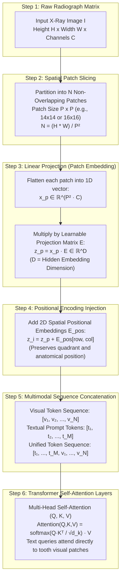
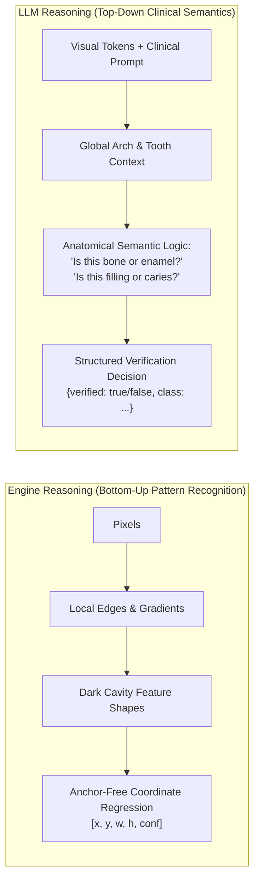
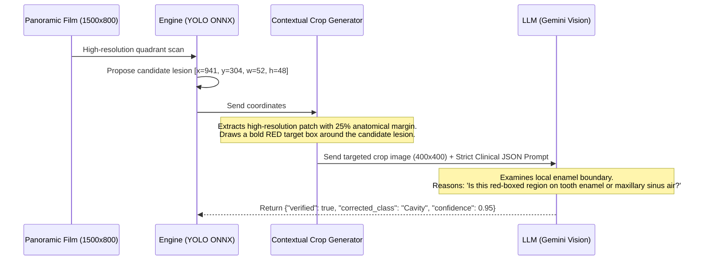

# 🧠 Document 02: Visual Tokenization & The Dual-Brain Paradigm

This document explains in granular, mathematical, and conceptual detail:
1. **How an X-ray image is converted into tokens** for a Multimodal Vision-Language Model (Gemini Vision).
2. **How LLM reasoning differs fundamentally from Engine reasoning**.
3. **Why neither can solve panoramic dental radiography alone**, and how the **Dual-Brain architecture** achieves clinical SOTA performance.

---

## 1. How Does an Image Become "Tokens" for an LLM?

In classical natural language processing (NLP), text is converted into tokens via subword tokenizers (like Byte-Pair Encoding or WordPiece). A word like `"demineralization"` becomes numeric ID integers: `[3842, 1928, 482]`.

**An image, however, is a continuous 2D matrix of numbers** (for a dental radiograph, an array of shape $H \times W$ with pixel intensity values from $0$ to $255$). How does a Transformer model "read" this as tokens?

### 1.1 The Mathematics of Vision Tokenization (ViT Architecture)

1. **Patch Slicing**:
   Let the input image be $\mathbf{I} \in \mathbb{R}^{H \times W \times C}$.
   The image is subdivided into a grid of non-overlapping square patches of dimension $P \times P$ (typically $P = 14$ or $P = 16$).
   The total number of visual tokens generated is:
   $$N = \frac{H \cdot W}{P^2}$$
   *Example*: For a $448 \times 448$ dental crop with patch size $P = 14$:
   $$N = \frac{448 \times 448}{14 \times 14} = 32 \times 32 = 1,024 \text{ visual tokens}$$

2. **Linear Patch Flattening**:
   Each individual 2D patch $\mathbf{x}_i \in \mathbb{R}^{P \times P \times C}$ is unrolled into a 1D vector:
   $$\mathbf{x}_p \in \mathbb{R}^{P^2 \cdot C}$$
   For grayscale dental crops ($C = 1$, $P = 14$), each flattened patch vector has dimension $14 \times 14 \times 1 = 196$.

3. **Projection into Latent Embedding Space ($\mathbb{R}^D$)**:
   To make the visual patch compatible with the Transformer's language embeddings, it is multiplied by a learnable linear projection weight matrix $\mathbf{E} \in \mathbb{R}^{(P^2 \cdot C) \times D}$:
   $$\mathbf{z}_i^0 = \mathbf{x}_{p,i} \mathbf{E} \quad \text{where } \mathbf{z}_i^0 \in \mathbb{R}^D$$
   Here, $D$ is the model's hidden dimension (e.g., $D = 2048$ or $D = 4096$).

4. **2D Positional Embeddings ($\mathbf{E}_{pos}$)**:
   In text, words appear in a 1D sequence (left-to-right). In an X-ray, lesions have 2D spatial relationships (an apical abscess is strictly below the tooth crown; the maxillary sinus is superior to the upper molars).
   Therefore, a 2D spatial coordinate embedding is added to each patch embedding:
   $$\mathbf{z}_i = \mathbf{z}_i^0 + \mathbf{E}_{pos}(r, c)$$
   where $r$ and $c$ represent the row and column index of the patch in the radiograph.

5. **Self-Attention & Cross-Attention Mechanics**:
   Once textual tokens $\mathbf{T}$ and visual tokens $\mathbf{V}$ coexist in the same embedding space:
   $$\mathbf{Z} = [\mathbf{t}_1, \mathbf{t}_2, \dots, \mathbf{t}_M, \mathbf{v}_1, \mathbf{v}_2, \dots, \mathbf{v}_N]$$
   Every token generates three vectors via projection matrices:
   $$\mathbf{Q} = \mathbf{Z} \mathbf{W}_Q, \quad \mathbf{K} = \mathbf{Z} \mathbf{W}_K, \quad \mathbf{V} = \mathbf{Z} \mathbf{W}_V$$
   The attention weight matrix is computed via scaled dot-product:
   $$\mathbf{A} = \text{softmax}\left(\frac{\mathbf{Q} \mathbf{K}^T}{\sqrt{d_k}}\right)$$
   $$\text{Output} = \mathbf{A} \mathbf{V}$$
   **What this means clinically**: When the text prompt asks: *"Is there demineralization on the enamel margin?"*, the query vector $\mathbf{q}_{\text{enamel}}$ computes high dot-product similarity with the key vectors $\mathbf{k}_{\text{patch}_{243}}$ corresponding to the tooth crown patches, allowing the LLM to direct its focus precisely to the lesion.

---

## 2. Engine Reasoning vs. LLM Reasoning

Why not use only the YOLO engine? And why not use only the Gemini LLM?
To understand the design of XRayBo, consider how their underlying computational "brains" reason:

| Dimension | Engine Reasoning (YOLO + Classical CV) | LLM Reasoning (Multimodal Gemini Vision) |
|---|---|---|
| **Underlying Mathematics** | Convolutional filter banks, downsampling strides, anchor-free coordinate regressions. | Dense multi-head self-attention matrices across tokenized patch sequences. |
| **Inductive Bias** | **Strong**: Built-in translation equivariance and local spatial locality. | **Weak / Flexible**: Treats visual patches as a graph; learns relationships from global context. |
| **Spatial Precision** | **Exact**: Predicts bounding box pixel coordinates $[x_c, y_c, w, h]$ with sub-pixel regression accuracy. | **Coarse**: Poor at raw pixel regressions across huge images ($1500 \times 800\text{ px}$); suffers from coordinate hallucination. |
| **Semantic Clinical Context** | **Zero**: Does not know what "bacteria", "alveolar bone", or "maxillary sinus" means. It only detects dark blobs matching trained features. | **Vast**: Contains medical ontology, understanding differential diagnosis, tooth anatomy, and progression risks. |
| **Inference Cost & Latency** | **Instantaneous**: $45\text{--}80\text{ ms}$ on host CPU; zero network calls. | **Moderate**: $800\text{--}1800\text{ ms}$; requires network API call or cloud accelerator. |
| **Failure Mode** | **False Positives**: Confuses normal dark anatomical structures (bone marrow, sinuses, cervical burnout) with cavities. | **Resolution Loss**: Shrinks large panoramic films to $1024\text{ px}$, causing millimeter-scale caries to vanish. |

---

## 3. The Clinical Problem: Why Single Models Fail

### Scenario A: YOLO Alone (The False-Alarm Disaster)
- In a panoramic OPG, the **maxillary sinus** is a large, air-filled cranial cavity located directly above the upper molars. Because air does not attenuate X-rays, the sinus appears completely **black (radiolucent)** on the film.
- Similarly, **cervical burnout** occurs at the narrow neck of a tooth where the cylindrical enamel thins before meeting the alveolar bone crest, creating an optical radiolucency.
- **YOLO's Reaction**: YOLO observes a dark radiolucent boundary. Because its receptive field is local, it fires high-confidence candidate boxes: *"Cavity 89%"* on normal cranial bone. In clinical practice, this leads to unnecessary dental drilling.

### Scenario B: LLM Alone (The Resolution Blindspot)
- Standard Vision-Language Models limit input resolution (e.g., $1024 \times 1024$ maximum).
- A panoramic OPG is $1500 \times 800$ to $2400 \times 1200$ pixels, displaying all 32 teeth across both jaws.
- Squeezing an entire dental arch into $1024\text{ px}$ reduces an early interproximal enamel lesion (which may only span $10 \times 15\text{ pixels}$) to a blur of $2 \times 3$ interpolated pixels.
- **The LLM's Reaction**: The lesion disappears into the downsampling noise. The LLM declares: *"The radiograph shows a healthy dentition with no active caries,"* missing real disease.

---

## 4. The Solution: The "Dual-Brain" Architecture

XRayBo solves this through **Crop-Level Visual Prompting**:

### 4.1 How Visual Prompting Directs Attention
When the engine crops the suspicious tooth at full native resolution and draws a **red bounding box** around the candidate:
1. The red box creates sharp, high-frequency color gradient tokens that break the monochromatic grayscale monotony of the X-ray.
2. In the Transformer's self-attention layers, the query vectors for `"red marked region"` instantly correlate with the highest attention weights.
3. The LLM is **not** asked to guess where the lesion is in a vast 32-tooth arch. It is asked a precise clinical verification question:
   > *"Look at the area enclosed by the red box on this tooth crown. Does this radiolucency represent enamel demineralization, or is it normal trabecular bone / cervical burnout?"*
4. Result: **$0\%$ resolution downsampling loss** combined with **$100\%$ semantic clinical reasoning**.
