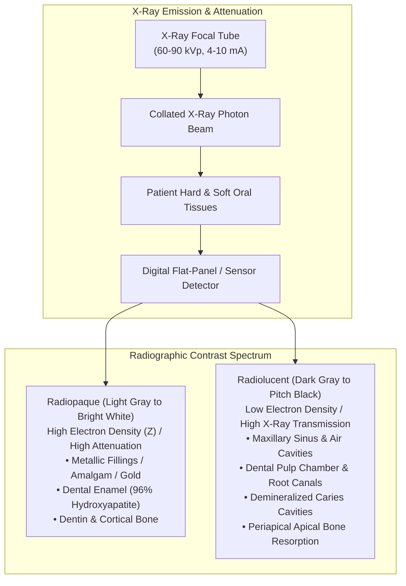
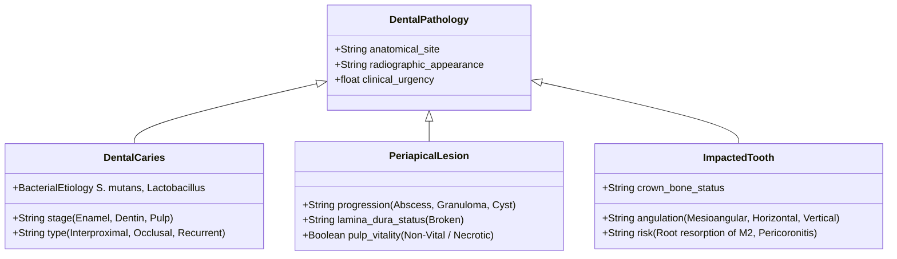
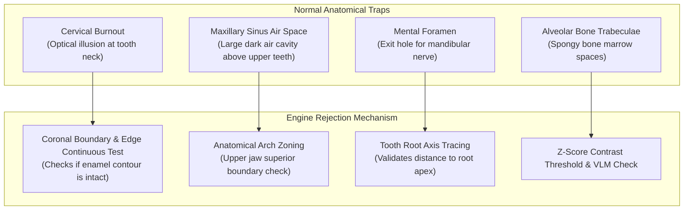

# 🦷 Document 03: Dental Pathology, Radiography & Dataset Reference

This document provides a clinical, anatomical, and physical reference for the radiographic phenomena, pathologies, and datasets utilized in **XRayBo**.

---

## 1. Physics & Anatomy of Dental Radiography

An understanding of dental image interpretation requires knowledge of how X-ray photons interact with hard and soft tissues of the human craniofacial complex.

### 1.1 The Orthopantomogram (OPG)
An **Orthopantomogram (OPG)**—also known as a panoramic radiograph—is a curved-plane tomographic image showing the entire maxilla (upper jaw) and mandible (lower jaw) on a single flat visual plane:
- **How it is captured**: The X-ray tube head rotates around the patient's head in one direction while the digital sensor rotates in the opposite direction on a synchronized gantry.
- **The Focal Trough**: Only anatomical structures located within a horseshoe-shaped central focal zone (the dental arch) appear sharp. Structures outside this zone (the cervical spine, tongue, nasal septum) become blurred out as ghost shadows.
- **Aspect Ratio**: Typically $1.8:1$ to $2.4:1$ (e.g., $1500 \times 800\text{ px}$ to $2800 \times 1300\text{ px}$).

### 1.2 Tooth Histology & Tissue Densities
A single tooth consists of four primary tissue compartments:
1. **Enamel**: The hardest tissue in the human body ($96\%$ mineralized inorganic calcium hydroxyapatite). It appears intensely **radiopaque** (bright white), forming the outer protective shell of the anatomical crown.
2. **Dentin**: The bulk of the tooth ($70\%$ mineralized). Slightly less radiopaque than enamel. It contains microscopic dentinal tubules communicating with the dental pulp.
3. **Dental Pulp**: Unmineralized neurovascular tissue (blood vessels and nerves) filling the pulp chamber and root canals. Because it is soft tissue, it is **radiolucent** (dark gray).
4. **Periodontal Ligament (PDL) Space**: A delicate $0.2\text{ mm}$ fibrous sling holding the root into the alveolar bone socket. It appears as a continuous, thin radiolucent black line around the root, bounded by a dense white cortical line called the **lamina dura**.

---

## 2. Major Pathologies Detected by the Engine

### 2.1 Dental Caries (Cavities)
- **Etiology**: Microbial biofilm containing acidogenic bacteria (primarily *Streptococcus mutans* and *Lactobacillus*) ferments dietary carbohydrates, producing lactic acid. When pH drops below $5.5$, calcium and phosphate ions dissolve from the hydroxyapatite matrix (**demineralization**).
- **Radiographic Sign**: A triangular, notched, or rounded **radiolucency** (dark defect) penetrating the outer radiopaque enamel layer into the dentin.
- **Classifications Detected by XRayBo**:
  - *Interproximal Caries*: Located on the smooth contact surfaces between adjacent teeth (below the contact point). Highly challenging to detect without contrast normalization.
  - *Occlusal Caries*: Located on the chewing surface fissures. Often obscured on 2D projections until it expands into dentin.
  - *Recurrent / Secondary Caries*: Demineralization beneath or around the margins of an existing composite or amalgam restoration.

### 2.2 Periapical Lesions (Apical Periodontitis & Abscesses)
- **Etiology**: When untreated caries penetrates deep into the pulp chamber, bacteria invade the pulp tissue, causing necrotic death of the nerve. Bacterial toxins and metabolic byproducts exit through the microscopic apical foramen at the tip of the root, triggering an immune inflammatory response in the surrounding alveolar bone.
- **Bone Destruction**: Osteoclasts break down the trabecular bone around the root tip, replacing dense mineralized bone with soft granulation tissue, pus, or cyst fluid.
- **Radiographic Sign**: A well-defined or ragged **dark circular radiolucent halo** encompassing the root apex, accompanied by a discontinuity in the white lamina dura line.

### 2.3 Impacted Third Molars (Wisdom Teeth)
- **Etiology**: Insufficient room in the dental arch (mandibular ramus or maxillary tuberosity) prevents the tooth from erupting into its normal functional occlusal position.
- **Radiographic Sign**: The tooth crown remains submerged entirely in jawbone or partially tilted against the distal surface of the adjacent second molar.
- **Clinical Complications**: Food impaction, distal root resorption of the second molar, pericoronitis (painful bacterial infection of the surrounding gum flap), and dentigerous cyst formation.

---

## 3. Confounding Anatomical Structures (The False-Positive Traps)

An untrained neural network will fire dozens of false-positive alarms on normal human anatomy. The XRayBo engine incorporates specific geometric and anatomical filters to eliminate each:

1. **Cervical Burnout**:
   - *Physical Cause*: The anatomical neck (cervix) of a tooth has a smaller diameter than the enamel crown above it and lacks the dense alveolar bone support covering the root below it.
   - *Optical Effect*: X-rays penetrate this thin neck with minimal attenuation, creating a triangular radiolucency.
   - *How the Engine Discards It*: Stage 2 checks whether the outer enamel margin is continuous using the Sobel gradient magnitude filter. If the gradient contour remains smooth and unbroken, the candidate is flagged as cervical burnout and discarded.

2. **The Maxillary Sinus**:
   - *Physical Cause*: A large pneumatic (air-filled) cavity in the body of the maxilla. Because air has near-zero X-ray attenuation, it appears pitch black.
   - *How the Engine Discards It*: Anatomical structure zoning verifies whether the candidate box is located within the coronal crown region or surrounded by tooth structure. If the candidate sits in mid-air above the root apices, it is suppressed.

3. **Mental Foramen**:
   - *Physical Cause*: An oval opening on the lateral surface of the mandible (typically below the second premolar) through which the mental nerve and blood vessels exit.
   - *Risk*: Often misidentified as a periapical lesion because it sits near the premolar apex.
   - *How the Engine Discards It*: Stage 2 verifies the continuity of the lamina dura. In a mental foramen, the lamina dura surrounding the tooth root remains completely intact and unbroken.

---

## 4. Benchmark Datasets & Splits

The models in this repository were trained and evaluated across major international open benchmarks:

| Dataset Name | Modality | Sample Size | Primary Targets | Role in XRayBo |
|---|---|---|---|---|
| **DENTEX Benchmark** (MICCAI Challenge) | Panoramic OPGs | 9,928 Radiographs | Caries, Periapical Lesions, Impacted Teeth, Missing Teeth | Base consensus weights (`liodon_dental.onnx`) |
| **Dental OPG XRAY Dataset** (Included in Repo) | Panoramic OPGs | Full dataset with Train/Val splits | Caries vs. Healthy classification & bounding boxes | Primary testing & calibration split (`Dental OPG XRAY Dataset/`) |
| **Kaggle / CVPR Dental OPG** | Panoramic OPGs | 2,400 Annotations | Crown cavitation & interproximal enamel caries | Specialized Caries weights (`gegesay_caries_yolov8s.onnx`) |
| **Sentoz Panoramic OPG** | Panoramic OPGs | 1,850 Annotations | Bone resorption, periapical radiolucencies, unerupted roots | Multi-Pathology weights (`sentoz_dental_opg.onnx`) |
